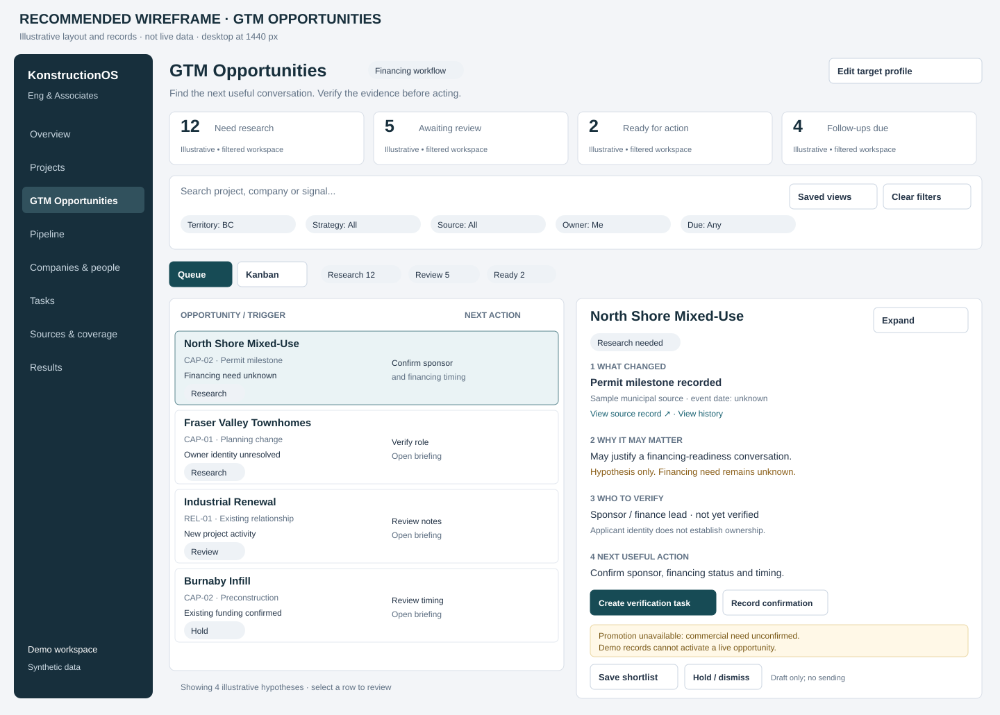
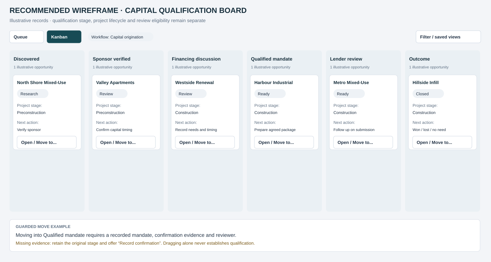

# Recommended GTM wireframe for Claude Code

Date: 2026-10-15
Status: recommended design and implementation contract; not an implemented application.
Companion: [GTM lead-source playbook](GTM_LEAD_SOURCE_PLAYBOOK.md).

## 1. Design recommendation

Use a queue-first workspace with an evidence-and-action panel, plus a separate qualification Kanban. The default page answers "Who should I speak with next, why now, and what must I verify?" Keep project facts visible alongside the commercial hypothesis.

Implement the commercial-finance slice here first. Contractor and commercial real estate variants use the same conceptual layout but retain the repository and auth boundaries in the playbook. The layouts below contain synthetic examples and sample counts, not actual demand, source coverage or customer outcomes.

These SVGs are editable, precise layout references. Their neutral navy/teal palette is provisional: map existing ClearConnect/Lovable design tokens into the actual application rather than rebranding or copying its Vite code. Pixel positions communicate hierarchy; functional requirements below take precedence over drawing shortcuts.

## 2. Information architecture and routes

Suggested routes; reconcile with existing routes before implementation. Do not create duplicate CRM screens.

| Navigation | Suggested route | Purpose | Build priority |
| --- | --- | --- | --- |
| Overview | /overview or existing home | Work due, evidence freshness and qualified activity | Reuse existing |
| Projects | /projects | Canonical project discovery and lifecycle | Reuse current workstream |
| GTM Opportunities | /gtm | Research/review queue, selected project briefing | First new screen |
| Pipeline | /gtm/pipeline | Segment qualification Kanban over the same opportunity records | Second |
| Companies & people | Existing company/contact routes | Verified roles and prior relationships | Link, do not duplicate |
| Tasks | Existing task route | Verification and follow-up work | Reuse |
| Sources & coverage | /sources | Source health, last successful import, permitted use and known gaps | Later |
| Results | /gtm/results | Attributable meetings, mandates and cohort learning | Later |
| Target profile | /settings/target-profile | Workspace geography, services, size, exclusions and capacity | Minimal form first |

Workspace switcher is display/navigation only; server-verified membership authorizes data. Demo/live mode must always be visible. Hide or clearly mark planned screens; no dead navigation disguised as completed functionality.

## 3. Screen A — opportunity queue

At approximately 1440px wide, use a 200–224px navigation rail, a fluid content area and a 16–24px gutter. Top bar contains title, active workflow and Edit target profile. Under it:
1. Four compact summary cards: Need research, Awaiting review, Ready for action, Follow-ups due.
2. Search and filters.
3. Queue/Kanban view switch plus review-queue tabs.
4. Two-column working area: about 48% opportunity list and 52% selected evidence panel.

Counts use the same workspace, segment and shared filters as the list; queue tabs then select a subset. Due is a task count, other cards are hypothesis counts. Label this distinction. Display "Showing X of Y"; paginate a real dataset and distinguish sample rows from totals in demos. Do not place aggregate project budgets in a revenue KPI.

| Region | Required content | Interaction |
| --- | --- | --- |
| Search/filter bar | Project/company/signal search; territory, strategy, source, owner, due, freshness, review state | Debounced search; clear-all; shareable safe filter state; saved view optional |
| Opportunity row/card | Project/city, segment/strategy, factual trigger/date, need/appointment state, next task/owner/due, review badge | Select opens briefing without losing list position; explicit Open link works by keyboard |
| Review tabs | Research, Review, Ready, Hold/disqualified | Counts and active state; query updates without silently changing qualification stage |
| Evidence panel | Selected opportunity, source links, commercial hypothesis, role gaps and action | Expand to full-width detail; close restores list selection/focus |
| Primary CTA | Create verification task when information is missing; Review evidence when ready to review | One contextual primary action, not a grid of competing buttons |

Default sort: due/overdue verification task first, then current verified relevant event, then stable ID. Unknown dates sort last in the event bucket. Allow users to change sort and show the selected order. No fabricated score or "hot lead" badge.

Use a table only where columns remain readable; use stacked cards at narrower widths. Show units/currency and distinguish event date, observed date and verification date. Unknown means "Unknown", never a misleading zero.

## 4. Screen B — expandable project intelligence / opportunity detail

Selecting a queue row opens the preview. Expand opens a full-width detail route or accessible dialog; preserve selected opportunity and list filters in navigation state. Prefer a dedicated route for lengthy evidence editing and deep links.

Header: project name, city/type, construction lifecycle, review state, qualification stage, owner and Demo badge if applicable. Actions: expand/restore, zoom 80–140%, reset, close/back. If scaling text, let content reflow and scroll without clipping. Do not scale the entire UI in a way that breaks keyboard targets.

Full detail uses tabs: Briefing (default), Evidence, Stakeholders, Activity. Each tab opens real content or an explicit empty state. Keep next action in a sticky side card on wide screens and a bottom action region on mobile.

| Briefing order | Content | Example from synthetic fixture |
| --- | --- | --- |
| What changed | Specific assertion, event date, publisher, source link and last verified date | Permit milestone recorded; event date unknown |
| Why it may matter | Strategy and inferred commercial relevance, explicitly identified as hypothesis | May justify asking whether financing readiness support is relevant |
| Who to verify | Business/person, project role, match confidence, relationship owner | Sponsor/finance lead not yet verified |
| What is missing | Need, ownership, timing, appointment, contact eligibility and contradictions | Financing need unknown; applicant may not be owner |
| Recommended action | A specific question/task, responsible user and due date | Confirm sponsor, financing status and timing |
| Review and promotion | Applicable gate checklist and clear action status | Internal promotion unavailable until qualification is evidenced |

Evidence tab: assertion → source/publisher/record ID → event/observation/verification dates → status → source link. Keep contradictory versions and correction history visible. Never expose a raw private evidence URL from another workspace.

Stakeholders tab: role rows or compact relationship cards with company/person, role evidence, identity confidence, appointment status and verified date. Unknown roles have "Create verification task". Do not invent names or treat an applicant as the owner.

Activity tab: sourced changes, research tasks, confirmations, reviewer decisions and promotion/outcome events, with actor/time and net-new/reactivation attribution. Notes are tenant private. Empty activity is not evidence that no prior relationship exists.

Expandable KPI/summary cards should show their underlying records and definitions. Reuse existing expandable-card/project-briefing components when available on the checked-out branch; they exist on feature/mock-dashboard, not necessarily main. Inspect before importing.

## 5. Screen C — verification and review form

Open from Create verification task or Record confirmation. Use an accessible dialog for a short task form; use a full page for lengthy qualification.

Task fields: question/action, related project/hypothesis, assignee, due date, evidence gap and private note. Default the question from the strategy, then allow editing. Task creation never confirms a need.

Confirmation fields: confirmed fact/type, status, evidence reference or authorized conversation note, confirmation date, confirming stakeholder and reviewer. Financing adds need status, amount/currency if actually requested, purpose, timing and current financing status; all can remain unknown where appropriate. Never prefill a loan request from a construction budget.

Footer: Cancel and Save confirmation. Saving may update review eligibility but cannot implicitly create an opportunity, send a message or grant a mandate.

Internal promotion review shows target project/company/contact, existing duplicate if any, qualification evidence, missing gates and the exact internal destination. CTA: "Create internal opportunity". Disable with a readable reason when blocked; not only a tooltip. Production endpoint must repeat all authorization, qualification and duplicate checks. Synthetic fixtures offer a labeled local demo simulation only.

Show success with the created opportunity link and audit event. A duplicate/retry opens the existing opportunity. Failure keeps entered data, offers retry and does not show a partial success.

## 6. Screen D — qualification Kanban

Use a single segmented workflow at a time. Initial capital columns:
Discovered → Sponsor verified → Financing discussion → Qualified mandate → Lender review → Outcome.

Each column shows opportunity count. Cards contain project/company, construction lifecycle, separate review badge, next action, owner, due date and Open/Move to controls. On a wide board, use ~220–260px columns; allow horizontal board scrolling when necessary, never squeeze text until unreadable.

Drag/drop is an enhancement. Every card has an accessible Move to action that opens stage choices and any required evidence form. This is the accessible counterpart to drag/drop, not a project-list dropdown used as the only pipeline UI. Include live announcements, visible focus, Escape cancellation and focus restoration.

Guard examples:
- Sponsor verified: verified identity and project role.
- Financing discussion: authorized stakeholder conversation/evidence.
- Qualified mandate: actual recorded mandate and review.
- Lender review: actual permitted submission/review evidence; dragging does not submit a file.
- Outcome: explicit won/lost/no need/other reason and supporting note; won requires documented business outcome.

Rejected move restores the previous column, explains missing evidence and offers Record confirmation. Persist successful moves only after the server accepts them; on network failure revert optimistic state and announce failure. Moving cards does not alter construction lifecycle or contact authorization.

Contractor and commercial real estate columns are defined in the playbook. Document the variant here, but do not implement the separate GPC/Atomic CRM workflow in this repository. No cross-workspace sharing is implied by showing the same conceptual project.

## 7. Mobile and responsive behavior

| Width | Layout |
| --- | --- |
| 1280px and above | Rail + list + briefing; four KPI cards in one row |
| 768–1279px | Collapsible rail; list occupies primary area; detail opens a sheet/full page when two columns become cramped; KPI cards wrap |
| Below 768px | Menu/workspace header → two-by-two compact counts → search/filter sheet → queue tabs → stacked cards; tap Open for full-page briefing |

On mobile, put the project title, review/need state, trigger and next action in the first viewport. Detail sections stack in the same reasoning order. Sticky primary action must not cover final fields or the device safe area. Minimum 44px touch targets. Kanban may scroll horizontally with named columns and an accessible stage-based list alternative; keep Move to available on every card.

Do not require hover, drag precision or zoom to read a record. Respect browser zoom, reduced-motion settings and high text scaling. Keep labels next to color badges; color alone cannot convey eligibility.

## 8. Required UI states

| State | Required behavior/copy |
| --- | --- |
| Loading | Skeleton list/detail and polite status; never show zero results before load completes |
| No target profile | "Set your target profile to find relevant projects"; research-only mode |
| No results | Show current filters and Clear filters; do not imply absent demand |
| No verified source coverage | "Coverage not verified for this area"; offer permitted manual research/import |
| Unknown financing need | "Financing need unknown"; offer verification, never "Funding required" |
| Incomplete score | "Scoring pending"; show known evidence, no invented /100 |
| Stale/conflicting/retracted evidence | Visible reason, relevant source dates and verification task; action eligibility re-evaluated |
| Suppressed contact | Contact action blocked with explanation; retain permitted internal research actions |
| Demo mode | Persistent disclosure and blocked live destinations |
| Unsaved changes | Preserve form data; warn before dismissing edits |
| Save/move error | Inline error, retained draft/previous stage and retry |
| Unauthorized/not found | Generic safe response; no cross-workspace existence disclosure |
| Source unavailable | Existing permitted snapshot with freshness warning; no false successful verification |

## 9. Suggested React composition

Use existing shadcn-compatible patterns and Next.js conventions; inspect package availability before importing. No framework migration is needed.

- GtmWorkspaceShell: active workspace/workflow, navigation, demo mode.
- OpportunityQueuePage: search, shared filters, pagination and selection.
- OpportunitySummaryCards: filtered definitions and expandable source records.
- OpportunityList / OpportunityRow: desktop list and responsive cards.
- OpportunityBriefingPanel / OpportunityDetail: same presentation model in preview/full view.
- EvidenceList, StakeholderRoles, VerificationGaps, NextActionCard.
- VerificationTaskDialog, ConfirmationForm, PromotionReview.
- QualificationBoard / QualificationCard / MoveStageDialog.
- TargetProfileForm and explicit loading/empty/error states.

Use server data access under verified workspace identity. Filters and workflow selectors are not authorization. Keep pure strategy/eligibility logic separate from presentation; server repeats protected checks. Reuse projects, companies, contacts, tasks and opportunities rather than duplicating the domain in UI-only stores. Mock provider and real provider should satisfy the same view-model contract with an explicit demo indicator.

## 10. Implementation order and review checklist

Build A plus B and task creation with synthetic fixtures first, then confirmation/review and capital Kanban. Add production persistence only after the playbook's tenant/source gates. Keep Sources/Results and acquisition landing pages out of the first UI slice.

Verify at desktop and mobile widths:
- Select/open/back preserves filters and focus.
- Evidence links and unknown states are readable without opening every tab.
- Expand, reduce, magnify, reset and Escape work where applicable.
- Task/confirmation/promotion are visibly separate actions.
- Tab/keyboard navigation, Move to, rejected moves and save failures work.
- Synthetic data never activates a live record.
- Counts and qualification state remain consistent after server responses.
- Existing project stage, routes, public frontend forms and CRM relationships remain intact.

Run available typecheck/lint/build and meaningful interaction/authorization checks for the implemented changes. This documentation update does not claim those application interactions have been built or tested.

## Pasteable Claude Code UI task

> Read docs/GTM_LEAD_SOURCE_PLAYBOOK.md and docs/GTM_WIREFRAME.md. Use the two SVG references as the layout guide. Inspect the actual branch and reuse available project briefing, expansion and Kanban components. Build the queue-first finance workspace with a selected evidence/action panel, full detail, verification task/confirmation forms and guarded capital qualification board. Preserve unknown financing need and demo boundaries; no fabricated scores. Support desktop/mobile, keyboard moves and clear loading/empty/error states. Start with synthetic data and one complete review flow; connect production only when verified tenancy and source gates pass. Report implemented screens and checks actually run.

## Enrichment process and UI

Follow [GTM_ENRICHMENT.md](GTM_ENRICHMENT.md) for project/company resolution, stakeholder and relationship enrichment, source-backed field assertions, bounded jobs and human review. Add the specified Enrichment tab to expanded detail and show the most relevant missing/changed fact in queue cards. Keep company identity, project role, contact accuracy, contact eligibility and commercial need visibly separate. Enrichment completion never automatically qualifies a prospect or sends outreach.

## Client Profile / client brain

Use [client.brain.md](../client.brain.md) as the profile contract. Expand Edit target profile into a Client Profile screen: identity and goals; strengths with proof; weaknesses/capability gaps; ranked opportunity interests; exclusions; capacity/economics; relationships; and review history. Show draft/approved version and required missing fields. Opportunity detail adds “Why this fits this client” and “What may prevent a fit”, tied to the active profile version. Accept/reject/defer feedback can propose a profile change for review. Actual client profiles remain tenant-private and must not be committed to this repository.

## Execution and learning additions

Follow [GTM_EXECUTION_LOOP.md](GTM_EXECUTION_LOOP.md) for an Offers tab in Client Profile, pursuit decision/rationale and ownership in opportunity detail, a Today view over existing tasks, and outcome/feedback capture with reviewed learning. Keep pursuit disposition separate from review eligibility, project lifecycle and qualification stage. Implement one offer → decision/owner → action → outcome flow before expanding results screens.

## Goals & Success view

Follow [GTM_GOALS_SUCCESS.md](GTM_GOALS_SUCCESS.md). Add a Client Profile tab and linked scorecard with goal statement, actual/target/baseline, gap/time remaining, source/update date and authorized drill-through. Show missing measurement explicitly; include blockers and next actions. Keep business outcomes distinct from tasks, enriched-record counts and SaaS acquisition metrics.
